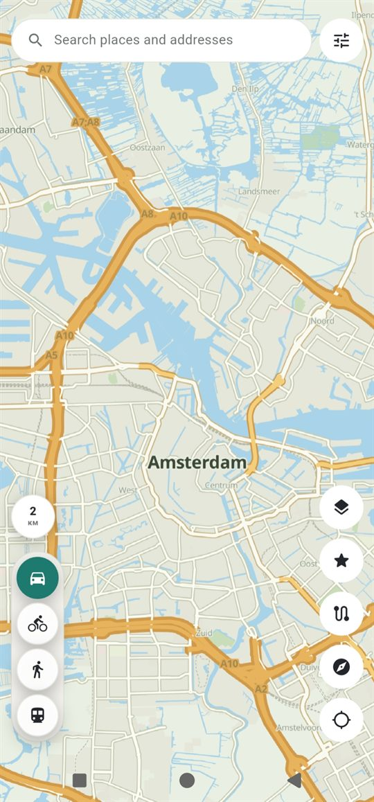
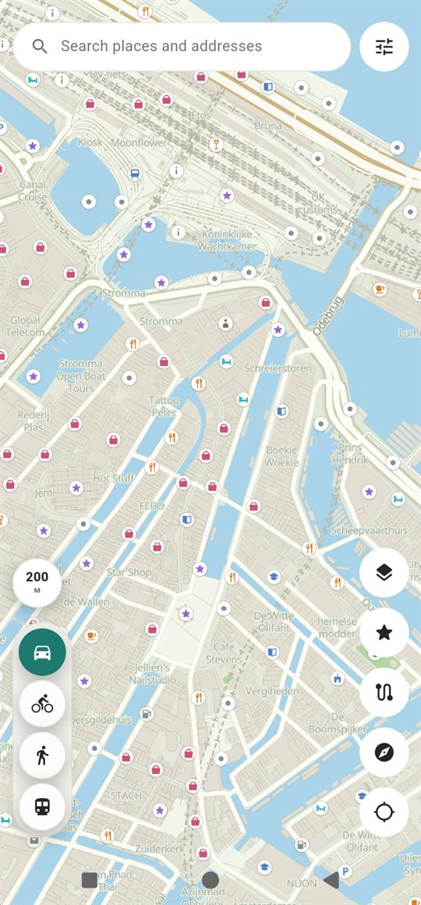
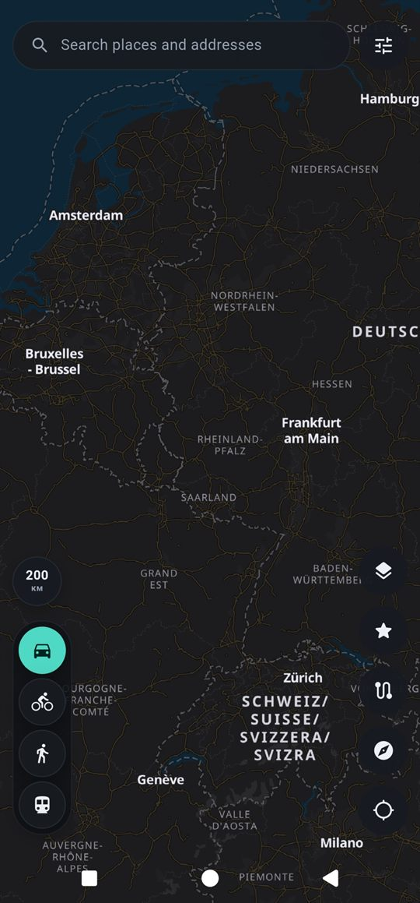

# Navigo


Navigo is an offline-friendly navigator for Android, built with Flutter and
MapLibre GL. It is designed around one idea: a map should stay calm — smooth
pan and zoom, labels that do not jump around, and a badge only where a badge
means something.

Everything runs on free, keyless services. No API key, no account, no paid
dependency.

## Screens

Atlas by day, Onyx by night — the same city at four scales, from the
motorway grid down to individual POI chips.

<table>
  <tr>
    <td align="center">
      <br>
      <b>Atlas</b> · 2 km — road hierarchy, ring motorways, rail
    </td>
    <td align="center">
      <br>
      <b>Atlas</b> · 200 m — category chips over the old centre
    </td>
    <td align="center">
      <br>
      <b>Onyx</b> · 200 km — the night network at country scale
    </td>
    <td align="center">
      <br>
      <b>Onyx</b> · 100 m — muted chips on charcoal
    </td>
  </tr>
</table>

## Features

- **Two map themes in the Apple Maps school** — Atlas for day and Onyx for
  night, written from scratch as inline style documents: own road hierarchy,
  own label ladder, own POI system of round category chips drawn at runtime.
- **Automatic day and night** from the NOAA solar position, no network needed.
- **Offline regions** for 56 countries and 90+ regions, three detail levels,
  download progress, installed list, delete.
- **Turn-by-turn navigation** with a foreground service, a lock-screen
  notification carrying the next maneuver, ETA and distance, and voice
  guidance that also works fully offline through on-device neural TTS.
- **Driving assist** — speed limits and fixed speed cameras read from
  OpenStreetMap through the Overpass API, cached per route, with two-stage
  alerts by voice and haptics.
- **Routing over several backends** — OSRM and Valhalla, with avoidances for
  tolls, motorways and ferries, plus toll and ferry badges on the summary.
- **Public transport** — lines, route colours and real-time flags from
  Transitous, which aggregates official GTFS feeds.
- **Places** — search, opening information, Wikipedia knowledge and Wikimedia
  Commons photos, with images cached on the device.
- **Saved places** — home, work and starred spots, stored locally.
- **Five languages** — English, Spanish, German, French and Russian, offline
  region names included.
- **Resilient loading** — a style is probed before use, with a watchdog and a
  raster fallback, so a tile outage degrades instead of going blank.
- The map always reopens exactly where it was closed.

## Build

```bash
flutter pub get
flutter build apk --release --split-per-abi
```

Known-good toolchain: Flutter 3.44.3, JDK 21, compileSdk 36 (Flutter's
default). The APKs appear in `build/app/outputs/flutter-apk/`.

Release signing uses a keystore that is deliberately **not** in this
repository. The CI job receives it from protected GitHub Actions secrets; see
the header of `.github/workflows/release.yml`. Without them the pipeline still
compiles an APK, but it cannot be published as an upgradeable release.

## Releases

Push a tag such as `v6.9.0` and GitHub Actions builds both ABIs and publishes
them to [Releases](https://github.com/Vincentdiligent/Navigo/releases). The
**Run workflow** button produces the same APKs as a downloadable artifact
without publishing.

## Installing an APK

Every release carries two files, and one is enough:

| File | Install it on |
| --- | --- |
| `…-arm64-v8a.apk` | practically any phone of the last eight years |
| `…-armeabi-v7a.apk` | older 32-bit devices |

Both are signed with the same release key, so a new release installs over an
older one and keeps saved places, downloaded regions and settings. An APK built
on your own machine — or by a fork — is signed with a debug key instead, and
Android will refuse to install it over a released build, or the other way
round, until the existing app is removed. That is a signature rule, not a bug.

Navigo is not on Google Play, so allow this source when Android asks. Offline
maps and voices are stored on the device, so keep a few hundred megabytes free
before downloading regions.

## Data sources and licenses

- Map data © [OpenStreetMap](https://www.openstreetmap.org/copyright)
  contributors (ODbL). Vector tiles and the Liberty style by
  [OpenFreeMap](https://openfreemap.org) (keyless). Positron and Dark Matter
  styles © CARTO.
- Atlas and Onyx styles adapt
  `dddevid/MapLibre-GL-JS-AppleMaps-Style` (MIT). Apple Maps is a trademark of
  Apple Inc.; this project is independent and not affiliated with Apple.
- Satellite imagery: Esri World Imagery (Esri, Maxar, Earthstar Geographics).
  Relief: OpenTopoMap (CC-BY-SA). Simplified fallback: the public
  OpenStreetMap raster tile servers, under their tile usage policy.
- Routing: OSRM demo server (FOSSGIS e.V.) and Valhalla at
  `routing.openstreetmap.de`. Roadworks and closures via the Overpass API
  (overpass-api.de and mirrors). Speed limits and camera positions are
  community OpenStreetMap tags — they can be incomplete or outdated, and
  nothing here is a substitute for the signs on the road.
- Geocoding: Nominatim, whose 1 request/s usage policy is enforced by an
  in-app serial gate. Place details and media from the Wikimedia Commons,
  Wikipedia and Wikidata APIs under their free licenses; the app sends an
  identifying User-Agent as the Wikimedia policy requires.
- Public transport: Transitous (`api.transitous.org`) aggregating official
  GTFS feeds.
- Offline speech: sherpa-onnx (Apache-2.0) with Piper `vits` models pulled on
  demand from Hugging Face; the bundled espeak-ng phonemizer tables in
  `assets/tts/` are GPL-3.0, and each voice keeps its own license.

## License

The source in this repository is not licensed for reuse yet — all rights are
reserved by the author. Third-party code, styles and data above keep their own
licenses.
